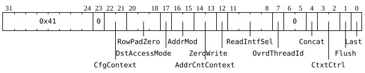

# `PACR` (Move datums from `Dst` to L1)

**Summary:** Issue work to the packer, which will move some number of datums from `Dst` to a contiguous range of L1, possibly performing some minor data transformations in the process. Between one and four `Dst` read interfaces can be enabled, and each enabled read interface contributes one row of `Dst`.

**Backend execution unit:** Packer

> [!TIP]
> Compared to Wormhole, Blackhole has a single packer with four `Dst` read interfaces in place of Wormhole's four packers, and `PACR` selects read interfaces (`ReadIntfSel`) rather than packers (`PackerMask`). The pipeline stages are otherwise similar to Wormhole's, for which see [`Packers/README.md` in the Wormhole tree](../../../WormholeB0/TensixTile/TensixCoprocessor/Packers/README.md); only the `Dst` read interface behavior is documented here.

## Syntax

```c
TT_PACR(/* u2 */ CfgContext, /* u3 */ RowPadZero, /* bool */ DstAccessMode,
        /* u2 */ AddrMod, /* u2 */ AddrCntContext, /* bool */ ZeroWrite,
        /* u4 */ ReadIntfSel, /* bool */ OvrdThreadId, /* bool */ Concat,
        /* u2 */ CtxtCtrl, /* bool */ Flush, /* bool */ Last)
```

## Encoding



## Functional model

### `Dst` read interfaces

The packer has four `Dst` read interfaces, and each enabled read interface reads one row of 16 datums from `Dst`. Read interface `i` always reads `Dst` row `(StartRow & ~3) | i`, where `StartRow` is the starting `Dst` row determined by the [input address generator](../../../WormholeB0/TensixTile/TensixCoprocessor/Packers/InputAddressGenerator.md), so all four read interfaces address the same aligned group of four `Dst` rows. `ReadIntfSel` is a mask relative to `StartRow`: hardware shifts it left by `StartRow & 3` to give the set of read interfaces to enable, so bit `k` of `ReadIntfSel` enables read interface `(StartRow & 3) + k`, which reads `Dst` row `StartRow + k`:

```c
uint4_t ReadIntfMask = CurrentInstruction.ReadIntfSel;
if (ReadIntfMask == 0) ReadIntfMask = 0b1111; // as a special case, 0 enables all four
if ((ReadIntfMask << (StartRow & 3)) > 0b1111) {
  UndefinedBehavior(); // every enabled read interface has to stay within the group of four
}
for (unsigned k = 0; k < 4; ++k) {
  if (ReadIntfMask & (1 << k)) {
    CurrentPacker.ReadDstRow(StartRow + k); // appended to the packed output
  }
}
```

The datums from the enabled read interfaces are packed to L1 contiguously, in increasing read interface order, with no gap or padding between rows. Each read interface always reads all 16 datums of its row, but only the datums selected by the ADC X range and by [downsampling](../../../WormholeB0/TensixTile/TensixCoprocessor/Packers/Downsampling.md) are packed, so a `ReadIntfSel` with `N` bits set packs `N * D` datums, where `D` is the number of datums packed per row (`16` when a whole row is packed). The packer's L1 write position advances by exactly that many datums, and for BFP formats its exponent write position advances by `N`.

|`ReadIntfSel`|`Dst` rows read, when `StartRow` is a multiple of four|Datums packed, whole rows|
|---|---|---|
|`0b0000`|`StartRow + 0`, `+1`, `+2`, `+3` (i.e. as `0b1111`)|64|
|`0b0001`|`StartRow + 0`|16|
|`0b0011`|`StartRow + 0`, `+1`|32|
|`0b0111`|`StartRow + 0`, `+1`, `+2`|48|
|`0b1111`|`StartRow + 0`, `+1`, `+2`, `+3`|64|
|`0b0101`|`StartRow + 0`, `+2`|32|
|Any other value|The rows named by its set bits, in increasing order|16 per set bit|

Masks with three bits set are useful for packing a tensor whose final group of rows is not a multiple of four rows long: packing 48 datums leaves the 49th onwards untouched in L1, whereas packing 64 datums and relying on edge masking or `RowPadZero` to zero the tail would write past the end of the data. Software can compute such a mask branch-free as `(1 << RowsRemaining) - 1`, which for four remaining rows gives `0b1111`; that behaves identically to `0`, so the `0` special case does not need to be special-cased by software. Note that the packer writes L1 in units of 16 bytes, so for sub-byte output formats, flushing the output buffers (via `Last`) will zero the remainder of the final 16 byte block: 48 datums of BFP4 occupy 24 bytes, and the eight bytes after them are zeroed.

Some late format conversions zero further than that. When `LateFromFormat` to `LateToFormat` is FP32 to FP16, FP16 to FP8, or BF16 to any BFP format, the packer converts the datums of a tile (the `PACR` instructions after the previous one with `Last` set, up to and including the next one with `Last` set) in groups of 128 bytes of `LateFromFormat` data. If the final group holds only `n` bytes of input, the packer writes the output for `min(2 * n, 128)` bytes of input, zero past the end of the data. For example, one row of 16 FP16 datums converted to FP8 is 16 bytes of output followed by 16 bytes of zeros, and five such rows are 80 bytes followed by 16 bytes of zeros. With `Pack_L1_Acc`, these zeros are accumulated like any other datum. Other conversions, FP32 to any BFP format among them, zero only the remainder of the final 16 byte block.

A tile can also end partway into a 32-byte unit of its input. If the datums are 16 or 32 bits wide in `Dst` (`In_data_format` is not an 8-bit or BFP format) and the tile's input ends 16 bytes into a 32-byte unit (8 datums of 16 bits, or 4 of 32 bits, past a multiple of 32 bytes), the packer completes that unit with zeros: after the data, it writes the output for 16 more bytes of input, each datum zero, and the grouping in 128 bytes above counts them as input. This happens, for example, when `ReadIntfSel` is `0b0001` and some of its `PACR` instructions pack 8 datums. A tile of 8 BF16 datums packed as BF16 is 16 bytes followed by 16 bytes of zeros, and the same tile packed as FP32 is 32 bytes followed by 32 bytes of zeros; a tile of 4 FP32 datums packed as FP32 is 16 bytes followed by 16 bytes of zeros, and converted to FP16 it is 8 bytes followed by 24 bytes of zeros (completed to 32 bytes of input, then the output of 64). With `Pack_L1_Acc`, these zeros are accumulated like any other datum. A tile whose input ends anywhere else in a 32-byte unit, or whose datums are 8 bits wide in `Dst`, gets no such zeros, only those of the final 16 byte block. A tile converted from 16-bit to 32-bit datums (FP16 or BF16 to FP32) is instead completed to a multiple of 8 datums: if it packs `D` datums, the packer writes `8 * ceil(D / 8) - D` zero datums after them, then 8 more when `D` is 8 past a multiple of 16 (the completion above) or when `D % 64` is between 33 and 39 inclusive. For example, 4 datums are followed by 4 zero datums, 18 by 6, and 36 by 12. Other widening conversions that end partway into a group of 8 datums get further zeros too, how many not yet characterized.

The L1 address of a tile is computed by its first `PACR` (see the [output address generator](../../../WormholeB0/TensixTile/TensixCoprocessor/Packers/OutputAddressGenerator.md)), with two exceptions. When `Out_data_format` is a BFP format, a change to the packer's channel 1 address counters between `PACR` instructions within the first four rows of the tile moves the whole tile, including the rows already packed, to the address the later `PACR` computes. When `In_data_format` and `Out_data_format` differ otherwise (any late format conversion, FP16 to BF16 included), such a change moves the whole tile in the same way if it comes before the tile has read 128 bytes from `Dst` (32 datums of 32 bits, or 64 of 16 bits; an `In_data_format` of BFP8 counts as 16 bits), and not after. Changing those counters or `L1_Dest_addr` anywhere within a tile packed to a BFP format, or before a converted tile has read 128 bytes from `Dst`, is `UnsupportedFunctionality`. A tile whose formats are the same keeps its first address.

> [!TIP]
> The `THCON_SEC0_REG1_Auto_set_last_pacr_intf_sel` configuration field causes hardware to compute `ReadIntfSel` for the final `PACR` of an xy plane from the number of rows remaining in the plane, which produces exactly the `0b0001` / `0b0011` / `0b0111` / `0b1111` masks.

The tile position used for [edge masking](Packers/EdgeMasking.md) advances by the number of enabled read interfaces per `PACR`, not by the number of datums each of them read, with the `k`'th enabled read interface (counting only enabled interfaces) using tile row position `TilePosition + YStart + k`, where `YStart` (usually zero) depends on the packer's `Dst` offset. `TilePosition` is an 8 bit counter whose low four bits give the tile row; it returns to zero, starting the next xy plane, only when advancing it lands exactly on `PACK_COUNTERS_SEC0_pack_reads_per_xy_plane`, so if the number of enabled read interfaces does not divide the configured rows per xy plane, the counter steps over that value and keeps incrementing instead.

### Strided reads (`DstAccessMode`)

With `DstAccessMode` set, the read interfaces read rows 8 apart instead of adjacent rows, or 16 apart when `DEST_ACCESS_CFG_remap_addrs` is set. Read interface `i` reads the row whose bits 4:3 (bits 5:4 with `remap_addrs`, which moves them to bits 4:3 of the address `Dst` sees) are `i`, the other bits taken from `StartRow`, and `ReadIntfSel` is shifted left by the start row's own interface, as it is by `StartRow & 3` in the normal mode:

```c
unsigned Stride = Config.DEST_ACCESS_CFG_remap_addrs ? 16 : 8;
unsigned Pos = (StartRow / Stride) & 3; // the read interface of StartRow itself
uint4_t ReadIntfMask = CurrentInstruction.ReadIntfSel;
if (ReadIntfMask == 0) ReadIntfMask = 0b1111;
if ((ReadIntfMask << Pos) > 0b1111) {
  UndefinedBehavior(); // every enabled read interface has to stay within the group of four
}
for (unsigned k = 0; k < 4; ++k) {
  if (ReadIntfMask & (1 << k)) {
    CurrentPacker.ReadDstRow(StartRow + k * Stride); // appended to the packed output
  }
}
```

Each row is then read as in the normal mode: a `Dst16b` row through `Adj16`, a `Dst32b` row through `Adj32`, each with its valid bit as described in [`Dst`](Dst.md). Everything else (the ADC X range, edge masking and the tile position, which advances by the number of enabled read interfaces, conversion and the output) is as in the normal mode. For example, with `remap_addrs` set, a `PACR` with `ReadIntfSel` of `0b0011` and a `StartRow` of `64 + r` packs row `r` of the 16-row faces at rows 64 and 80, one after the other, which is how an untilize pack gathers a row of a tile.

A strided read of 32-bit data (`PCK_DEST_RD_CTRL_Read_32b_data`) assumes the `DEST_ACCESS_CFG_swizzle_32b` layout: with `swizzle_32b` clear it reads other datums, not described here. Strided 16-bit reads work under either value of `swizzle_32b`. `DstAccessMode` has no effect on a `PACR` with `ZeroWrite`, which reads nothing from `Dst`.

### Configuration contexts

The packer has four configuration contexts, each its own copy of most of the packer's configuration, and every `PACR` uses one of them. `CfgContext` names the context, unless bit 0 of `CtxtCtrl` is set, in which case the context comes from a two bit counter, one per configuration state, that steps after each such `PACR` with `Last` set, so that consecutive tiles cycle through the four contexts. A `PACR` with `CtxtCtrl` of `0b10` packs nothing and only returns the counter to zero:

```c
uint1_t StateID = ThreadConfig[CurrentThread].CFG_STATE_ID_StateID;
uint2_t Ctx = (CurrentInstruction.CtxtCtrl & 1) ? Packer.ContextCounter[StateID] : CurrentInstruction.CfgContext;
if (CurrentInstruction.CtxtCtrl == 0b10) {
  // Nothing is read from Dst or written to L1, Last is ignored (the open tile carries on), and the
  // tile position does not move; AddrMod still applies to the ADCs.
} else {
  // The PACR runs as described on this page, with configuration context Ctx.
}
if ((CurrentInstruction.CtxtCtrl & 1) == 0) {
  Packer.ContextCounter[StateID] = 0;
} else if (CurrentInstruction.Last) {
  Packer.ContextCounter[StateID] += 1; // wraps from 3 to 0
}
```

The counter steps once per tile only while `PACK_COUNTERS_SEC[Ctx].auto_ctxt_inc_xys_cnt` is zero; other values are not yet documented. `CtxtCtrl` values `0b01` and `0b11` behave identically then. Each configuration state's counter starts at zero after reset and only `PACR` changes it, so code that relies on the counter should begin with a `PACR` that has `CtxtCtrl` of `0b00` or `0b10`. Changing context partway through a tile (between `PACR` instructions after one with `Last` set and up to the next one with `Last` set) is not yet characterized: the open tile, like the [tile position](Packers/EdgeMasking.md) used for edge masking, belongs to the packer rather than to a context.

Context `Ctx` reads these fields:

|Fields|Context 0|Context 1|Context 2|Context 3|
|---|---|---|---|---|
|`L1_Dest_addr`, `In_data_format`, `Out_data_format`, `Exp_section_size`, `Sub_l1_tile_header_size`, `pack_dis_y_pos_start_offset`, `Downsample_mask`, `Pack_L1_Acc` and the other per-packer fields of `THCON_SEC0_REG1`|`THCON_SEC0_REG1_*`|`THCON_SEC0_REG8_*`|`THCON_SEC1_REG1_*`|`THCON_SEC1_REG8_*`|
|`pack_start_intf_pos`, `Pac_LF8_4b_exp`|`THCON_SEC0_REG1_*`|`THCON_SEC0_REG1_*`|`THCON_SEC1_REG1_*`|`THCON_SEC1_REG1_*`|
|`pack_reads_per_xy_plane` and the rest of `PACK_COUNTERS`|`PACK_COUNTERS_SEC0_*`|`PACK_COUNTERS_SEC1_*`|`PACK_COUNTERS_SEC2_*`|`PACK_COUNTERS_SEC3_*`|
|`pack_concat_mask`|`PACK_CONCAT_MASK_SEC0_*`|`PACK_CONCAT_MASK_SEC1_*`|`PACK_CONCAT_MASK_SEC2_*`|`PACK_CONCAT_MASK_SEC3_*`|
|`Pack_limit_address`, `Pack_fifo_size`|`THCON_SEC0_REG9_Pack_0_2_*`|`THCON_SEC0_REG9_Pack_1_3_*`|`THCON_SEC1_REG9_Pack_0_2_*`|`THCON_SEC1_REG9_Pack_1_3_*`|
|`Offset`, `ZOffset` (the `Dst` offset)|`DEST_TARGET_REG_CFG_PACK_SEC0_*`|`DEST_TARGET_REG_CFG_PACK_SEC1_*`|`DEST_TARGET_REG_CFG_PACK_SEC2_*`|`DEST_TARGET_REG_CFG_PACK_SEC3_*`|
|Edge-mask table selectors (see [edge masking](Packers/EdgeMasking.md))|bits 1:0|bits 3:2|bits 5:4|bits 7:6|

`THCON_SEC0_REG8` and `THCON_SEC1_REG8` hold the same per-packer fields as a `REG1`, at the same bit positions, except that `Add_tile_header_size` and `pack_dis_y_pos_start_offset` sit at bits 17 and 18 of their third word (bits 22 and 23 in a `REG1`). Everything else the packer reads is shared by the four contexts, including the ADC strides (`PCK0_ADDR_CTRL_*`, `PCK0_ADDR_BASE_*`), `PCK_DEST_RD_CTRL`, the ReLU and format fields outside `THCON`, and the edge-mask tables, masks, mode and `PCK_EDGE_TILE_FACE_SET_SELECT_enable`.

### `RowPadZero`

`RowPadZero` pads the packed data with zero datums. Its low two bits say when an instruction pads, and its high bit says what:

|`RowPadZero & 3`|The instruction pads|
|---|---|
|`0`|Never|
|`1`|Always|
|`2`|When `Concat` is `false` or `Last` is `true` (a `PACR` with `Last` set always has `Concat` cleared)|
|`3`|When `Last` is `true`|

* `RowPadZero & 4` clear: each row the instruction packs (one per enabled read interface) is followed by zero datums up to 16 datums. With an ADC X range of 3 to 7, for example, each row packs its five datums and then eleven zeros. For a BFP output format, the row's datums occupy the first positions of its block and the zeros the rest.
* `RowPadZero & 4` set: after all of the instruction's rows, the packer adds zero datums up to the next multiple of 16 of a running count. The count is of every datum the packer has packed since reset or since the last such padding, in every `PACR` and every tile, padding included, so it carries over from one tile to the next. When the count is already a multiple of 16, no zeros are added, with one exception: on a `PACR` with `Last` set whose tile so far (padding included) amounts to a multiple of 128 bytes of `In_data_format` data, counting a datum of an 8-bit or BFP format as 2 bytes, the packer adds 128 bytes' worth of zero datums (32 datums of 32 bits, or 64 of the others).

The padding datums go through the rest of the packer as datums read from `Dst` with a value of zero would: they are converted to `Out_data_format`, and they count as part of the tile for the end-of-tile rules above (the completion of a 32-byte unit and the groups of 128 bytes). Padding does not change which `Dst` rows are read or the tile position used for edge masking.

The following are not yet characterized: `RowPadZero` with `ZeroWrite`, and whether the datums of a `PACR` with `ZeroWrite` count toward the running count; `RowPadZero & 4` with a BFP `Out_data_format`; and padding rows of 32-bit datums (an `In_data_format` of FP32, TF32 or INT32) whose X range starts at 12 or later.

### Output held until the next `PACR`

A `PACR` with `Last` clear, an `IntermediateFormat` of FP32 or INT32 and three or four enabled read interfaces (e.g. `ReadIntfSel` of `0b0111`, `0b1111` or `0`) keeps its output inside the packer until the next `PACR` starts, and until then the instruction counts as still being in the packer pipeline. A [`STALLWAIT`](STALLWAIT.md) on the same thread that waits for the packer (wait condition C3) between the two is therefore UndefinedBehavior: in practice it never finishes. Ending the sequence with a `PACR` that has `Last` set avoids it.

### `Flush`

A `PACR` with `Flush` set is UndefinedBehavior on Blackhole if any `PACR` has run since reset: in practice the packer keeps writing copies of data it already packed to L1 past the tile and never becomes idle, so a later wait for the packer never finishes. This holds whatever the formats, read interfaces and tile state, including right after a `PACR` with `Last` set. Software ends tiles with `Last` instead.

### Instruction fields

* `ReadIntfSel`: as above.
* `AddrMod`: used by the input address generator and the output address generator to manipulate ADC Y/Z values in preparation for the _next_ `PACR` instruction.
* `ZeroWrite`: used by the input address generator (to fetch datums from `/dev/null` rather than `Dst`). Nothing is read from `Dst`: every datum is packed as a zero read from `Dst` would be, so edge masking and ReLU have no effect on it, and the rest of the packer (format conversion, output address, the end of the tile, the `AddrMod` step) works as usual. The read interfaces are `ReadIntfSel` itself, not shifted by `StartRow & 3`, and each enabled one packs the datums of the ADC X range, as a row from `Dst` would. With `ZeroWrite`, a `ReadIntfSel` of `0` does not mean all four read interfaces: the instruction instead packs `X + 1` zero datums, where `X` is the whole X coordinate of the packer's channel 1 ADC (not its low four bits), in rows of 16 (each its own BFP block). That mode expects `X + 1` to be a multiple of 16 and channel 0's X to be 0; other X ranges are not yet characterized. The tile position used for edge masking advances on reads from `Dst`, so a `PACR` with `ZeroWrite` does not advance it, though one with `Last` set still restarts it.
* `OvrdThreadId`: used by the input address generator and the output address generator to determine which ADC is in use (see `AddrCntContext`).
* `Concat`: if [compression](../../../WormholeB0/TensixTile/TensixCoprocessor/Packers/Compression.md) is enabled, setting this to `true` causes the _next_ `PACR` instruction to continue the current compression row rather than starting a new compression row. If compression is disabled, then there is no inherent concept of compression row, and this field only has an effect via `RowPadZero`.
* `Flush`: UndefinedBehavior after any earlier `PACR` (see above).
* `Last`: used by the output address generator (flushes the output buffers sitting before L1 and causes the _next_ `PACR` instruction to start at fresh output addresses).
* `DstAccessMode`: selects the strided `Dst` read mode, in which the enabled read interfaces read rows 8 apart (16 apart with `DEST_ACCESS_CFG_remap_addrs`) rather than adjacent rows; see above.
* `RowPadZero`: pads the packed data with zeros, every row or up to the next multiple of 16 datums; see above.
* `CfgContext`, `CtxtCtrl`: select the configuration context; see above.
* `AddrCntContext`: with `OvrdThreadId` set, the instruction uses the ADCs of thread `AddrCntContext` (0, 1 or 2) rather than those of the issuing thread.

A lot of [backend configuration fields](BackendConfiguration.md) are consumed by the various stages in the packer pipeline. Some of those fields are sampled when the `PACR` instruction starts, with that sampled value consistently used throughout the lifetime of the instruction. Other fields are sampled when _some_ `PACR` instruction starts: if there are multiple `PACR` instructions in-flight, they will observe the value of these configuration fields as they were when _one_ of the in-flight instructions started. Finally, some fields are sampled at an unspecified point during the lifetime of a `PACR` instruction.
